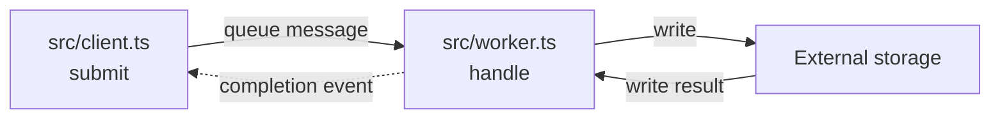
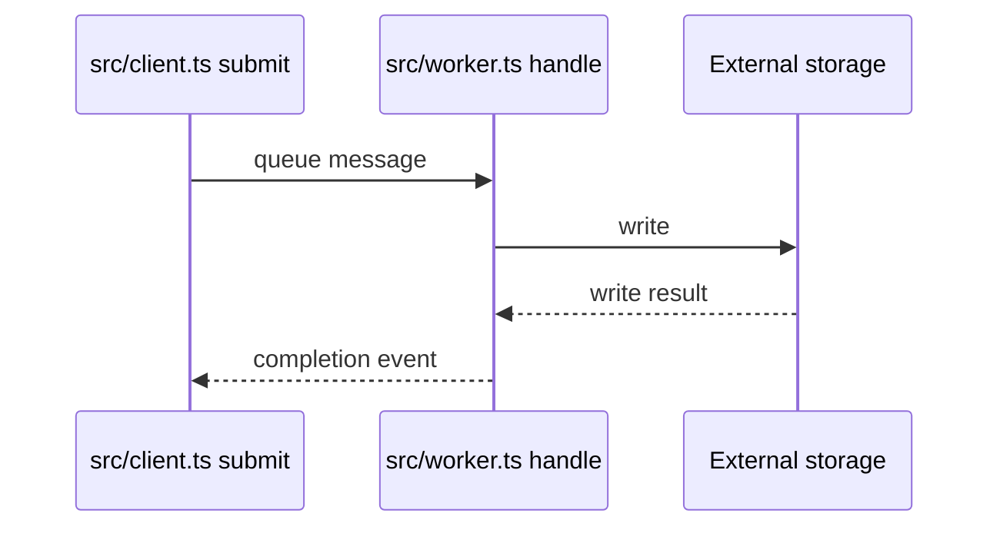

# Document shape

Use the evidence ledger to choose views. A small synchronous library may need
one diagram; a distributed service may need several.

## Reading order

| Section | Purpose |
| --- | --- |
| Scope and source state | Name the workflows, revision, readers, and exclusions. |
| Boundary overview and legend | Show participating subsystems and explain edge meanings. |
| Focused flows, when needed | Expand ordering, retries, state transitions, or platform differences. |
| Entry/exit table | Name each trigger and what its caller observes on completion. |
| Ownership summary | Identify who may mutate state, retry work, and settle a result. |
| Evidence gaps | Separate unknown connections from confirmed behavior. |

Group the overview by actual owners: callers, services/modules, workers,
external systems, and storage as applicable. Do not force a frontend/backend
split onto a library or command-line tool.

## Example: an asynchronous boundary

This is illustrative, not evidence about the target repository. Replace every
label and edge with traced source facts.

Where precise ordering matters, show the result path explicitly:

Use the target language's real symbols. Include intermediary transport,
adapter, or queue owners when they affect admission or completion.

## Entry/exit table

| Trigger | Entry file/symbol | Owner of completion | Observable exit |
| --- | --- | --- | --- |
| Named workflow | Exact caller | Component that settles it | Result type, event, UI state, or error |

“Returns” alone is not an exit description. Record supported failure,
cancellation, and retry outcomes as well as success.
